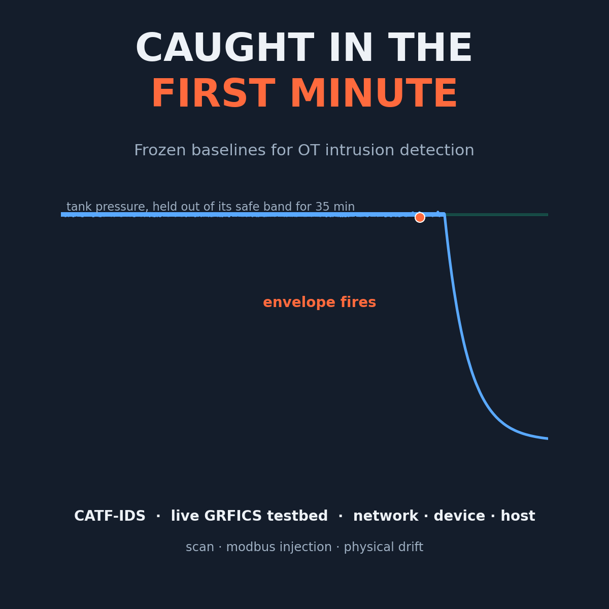
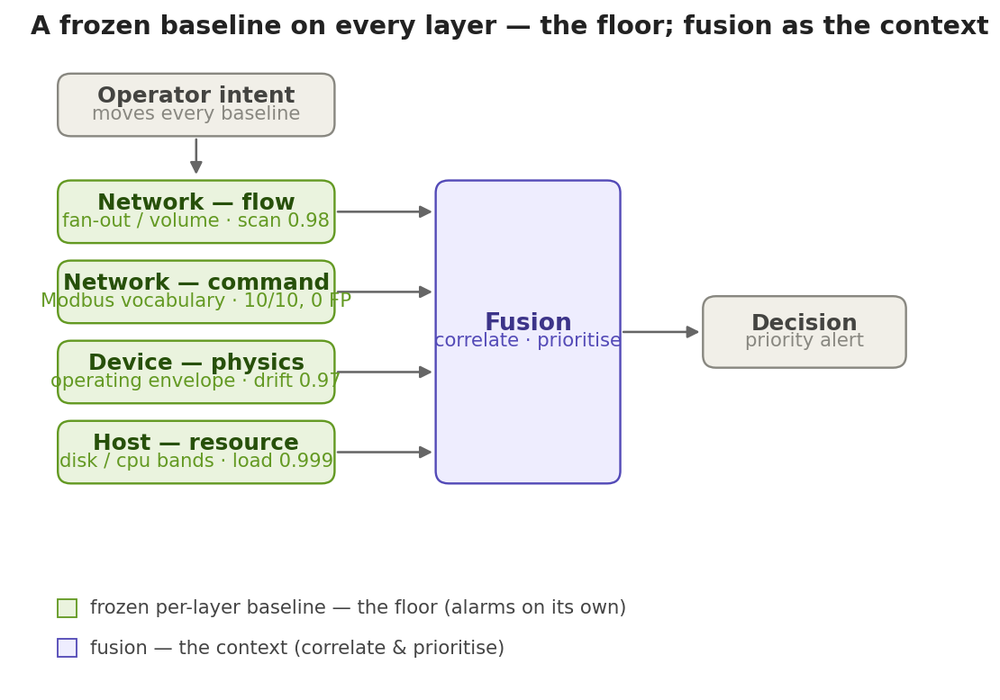
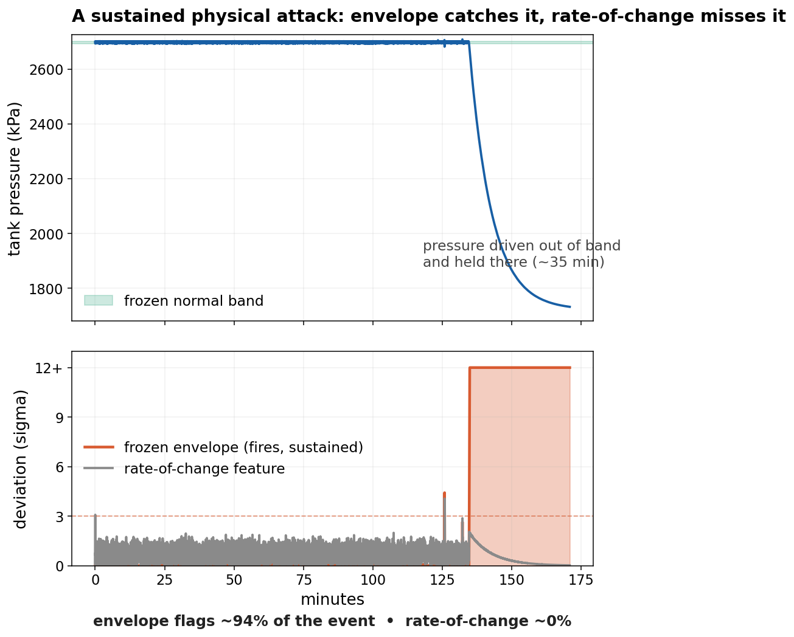

# Multi-modal intrusion detection on a live OT/ICS testbed

What happens when you take a multi-modal IIoT intrusion-detection system off its
benchmark and run it on a **real industrial process**? This repo is that
experiment: a live OT testbed, a recorded multi-stream attack session, and a set
of detection findings that only hold up once you evaluate the way you *deploy* —
train on the past, test on the future.

Built on **CATF-IDS**, a multi-modal IDS (network + device-physics + host).
*Paper in preparation — the core pipeline is not included here; this repo is the
testbed, the OT-specific extensions, and the findings.*

---

## The testbed

[GRFICSv3](https://github.com/Fortiphyd/GRFICSv3) in Docker — a Tennessee-Eastman
style chemical plant with a real soft-PLC (OpenPLC), a 3-D physics simulation with
six remote-I/O devices, a ScadaLTS HMI, a routed DMZ↔ICS network, and attacker
hosts. Three streams were recorded on one clock and converted to the detector's
schema:

| stream | source | rate |
|---|---|---|
| network | Zeek `conn` + `modbus` over self-healing PLC and router taps | per-flow |
| device | physics engine, 6 devices × (primary, secondary) signals | 1 Hz |
| host | `atop` process accounting | per-sample |

Attacks recorded: network **scan**, **Modbus command-injection**, **host
resource-load**, and a benign **noise-floor fault** that drove a **sustained
process upset** (tank pressure 2697 → 1733 kPa, held ~35 min).

## Findings

**1. Random cross-validation flatters a single recording — evaluate temporally.**
The full pipeline scored **F1 0.996** under shuffled 5-fold CV. Re-scored as a
deployed detector sees data (train past → test future), the aggregate fell to
~0.90 and the per-class story changed:

| split | scan recall | injection recall |
|---|---|---|
| random CV | 1.00 | **0.76** |
| temporal (past→future) | 1.00 | **0.00** |

The injection score was a shuffling artefact. A supervised detector catches attack
*types it has seen* and misses *novel* ones.

**2. A frozen, unsupervised baseline on every layer** — learn only *normal*,
freeze it, alert on deviation per layer. Catches attacks it was never trained on:

| layer | frozen baseline | result |
|---|---|---|
| network — flow | connection / fan-out bands | scan, AUC 0.98 |
| network — command | normal Modbus `(src, func, register)` vocabulary | injection + compromised-source, **10/10, 0 FP** |
| device — physics | per-device operating envelope | sustained drift, **AUC 0.97** |
| host | aggregate resource bands | resource-load, AUC 0.999 |

**3. The physical layer needs an operating envelope, not a rate-of-change feature.**
A slow sustained excursion has almost no rate of change, so `phys_delta` ranks it
below normal noise (AUC 0.31). A frozen, device-nature-aware envelope catches 94%
of the event where the derivative catches ~0%:

**4. OT needs protocol semantics.** An unauthorised Modbus write is protocol-valid
and invisible to a bytes-and-packets baseline. Capturing the command
(`modbus_detail.zeek` → `mb_func`/`mb_reg`/`mb_val`) and freezing the normal
command vocabulary catches the injection **10/10 with zero false positives** — and
also the harder *compromised-source* case (a legitimate PLC issuing an abnormal
command). See [`FINDINGS.md`](./FINDINGS.md) for the full write-up.

## Repo map

| file | what it does |
|---|---|
| `extract.sh`, `modbus_detail.zeek` | Zeek over the pcaps (incl. Modbus command semantics) + atop dumps |
| `lab_convert.py` | the three streams → the detector's CSV schema |
| `make_labels.py`, `mark.sh` | attack-window labelling (marks + self-labelling fault fields) |
| `phys_envelope.py` | the device-nature-aware frozen physical envelope (standalone) |
| `net_command_baseline.py` | the frozen Modbus command-vocabulary baseline (standalone) |
| `shot_list.md`, `runsheet_2h.md` | the attack-session design |
| `FINDINGS.md` | the full research record, honestly scoped |

## Reproduce

The capture/convert tooling and the two frozen baselines (`extract.sh`,
`modbus_detail.zeek`, `lab_convert.py`, `phys_envelope.py`,
`net_command_baseline.py`) are self-contained Python/Zeek/atop. The harnesses that
score the detector's full layer-model + fusion pipeline import CATF-IDS (paper in
prep) and are not in this repo. Requirements: Python 3.10+, pandas, numpy,
matplotlib; Docker (for Zeek); a GRFICSv3 instance.

